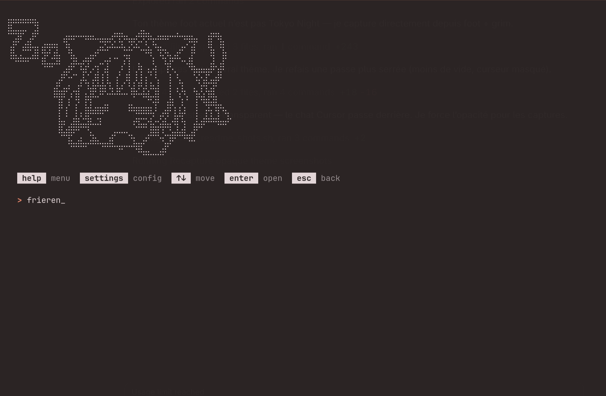
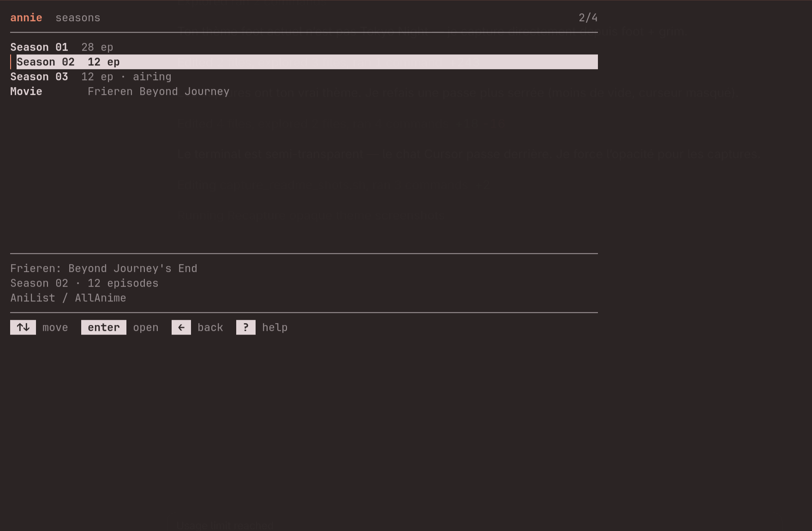
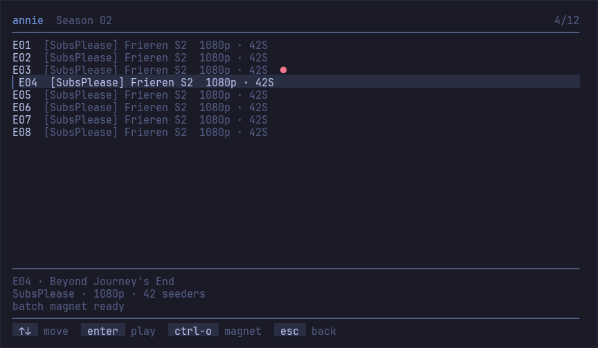
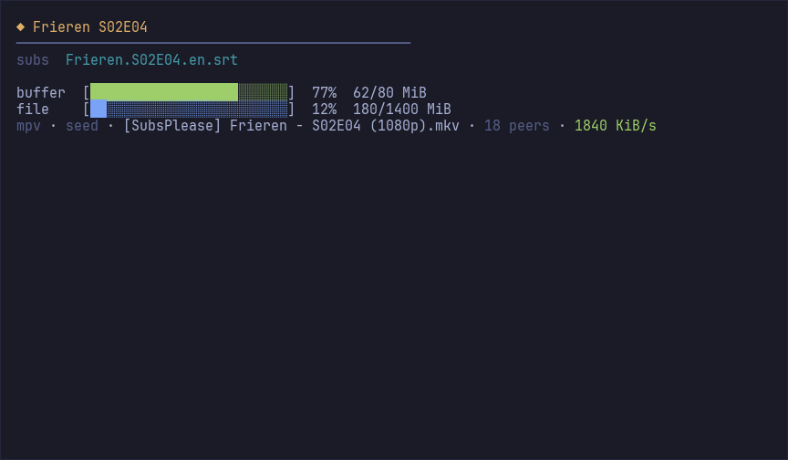

<h1 align="center">Annie</h1>
<p align="center">Anime from the terminal: search, pick, stream in mpv.</p>

<p align="center"></p>

## Install

```bash
curl -fsSL https://raw.githubusercontent.com/CloudDown/annie/main/install.sh | bash
```

From a clone: `make install` · on Omarchy: `make omarchy`.

<table>
  <tr>
    <td width="33%" align="center"><br /><sub>Pick a season</sub></td>
    <td width="33%" align="center"><br /><sub>Pick an episode</sub></td>
    <td width="33%" align="center"><br /><sub>Plays while it downloads</sub></td>
  </tr>
</table>

## Usage

```bash
annie                  # interactive prompt
annie watch frieren    # search and stream
annie search frieren   # search Nyaa only
```

| At the prompt | Result |
|---|---|
| `frieren s2` | Season 2 |
| `frieren s2e6` | Episode 6 + subtitles |
| `frieren movie` | Movies |
| `settings` / `help` | Settings / menu |

| Key | Action |
|---|---|
| **Super+Shift+I** | Open / focus (Omarchy) |
| **↑↓** · **Enter** · **Esc** | Move · select · back |
| **q** (mpv) · **Ctrl+C** | Quit player · quit Annie |

<p align="center"><a href="docs/GUIDE.md">Docs</a> · Personal tool, follow copyright law in your country.</p>
